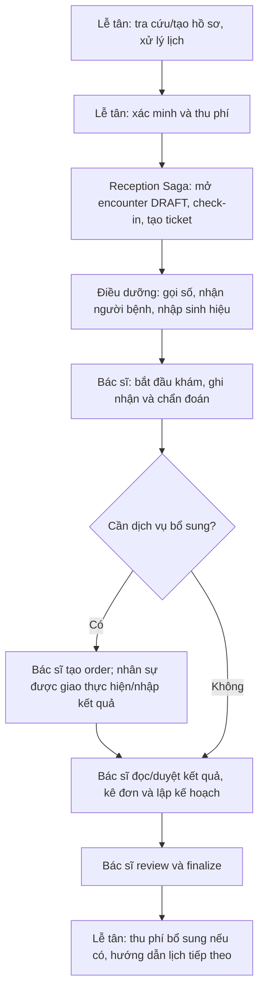

# Phân vai bác sĩ, lễ tân và điều dưỡng

Ngày rà soát: 2026-11-08.

Trạng thái: **Kết quả nghiên cứu source và đề xuất phân quyền**, không thay thế các quyết định APPROVED và không xác nhận hệ thống đã chạy đúng end-to-end. Các phần “hiện trạng” được kết luận từ code trong workspace; các phần “đề xuất” cần được đưa vào contract và implementation khi triển khai.

## 1. Kết luận

Repo đã có ba role `DOCTOR`, `RECEPTIONIST`, `NURSE`. Bác sĩ và lễ tân có service hồ sơ riêng cùng giao diện thao tác tương đối nhiều; điều dưỡng có role, workspace và một phần quyền ở backend, nhưng giao diện mới là trang tổng quan.

Với một phòng khám tư nhân, nên phân trách nhiệm chính như sau:

- **Lễ tân:** hồ sơ hành chính, đặt/đổi/hủy lịch, xác minh người bệnh, thu phí và tiếp nhận vào khám.
- **Điều dưỡng:** chuẩn bị người bệnh, gọi số tại phòng được phân công, nhập sinh hiệu, ghi nhận chăm sóc và số hóa tài liệu theo phân công.
- **Bác sĩ:** khám, ghi nhận chuyên môn, chẩn đoán, chỉ định, đọc/duyệt kết quả, kê đơn, lập kế hoạch điều trị và chốt hồ sơ.

Bác sĩ có thể hỗ trợ nhập sinh hiệu và gọi số. Đây là quyền hỗ trợ hợp lý trong phòng khám nhỏ; không cần xóa quyền này để phân vai. Ngược lại, điều dưỡng không được có quyền chẩn đoán, kê đơn hoặc chốt hồ sơ chỉ vì cùng tham gia khám.

Chưa cần `nurse-service`. Nghiệp vụ điều dưỡng tiếp tục nằm trong Queue, Medical Record và Document. Cần hoàn thiện phân công, quyền và giao diện trước khi cân nhắc service mới.

## 2. Nguồn và cách đối chiếu

Ưu tiên quyết định nghiệp vụ đã duyệt khi xác định hành vi mong muốn; dùng controller, service, guard và schema để xác định hành vi hiện có. Không coi menu frontend hoặc mô tả trong spec là bằng chứng API đã thực hiện đúng quyền.

| Nguồn | Nội dung sử dụng |
|---|---|
| [Decision log](decisions/private-clinic-service-decisions.md) | PC-001: một cơ sở; A06: đổi/hủy lịch; X01: admission; M03–M05: dữ liệu có cấu trúc, phân quyền và chốt hồ sơ; Q06: gọi số và override |
| [Luồng phòng khám](private-clinic-end-to-end-flow.md) | Admission, queue, Nurse nhập vital và Doctor ghi diagnosis/order/finalize |
| [Quy hoạch service](quy-hoach-microservices-use-case-thai-phu-kham-thai.md) | Role không đồng nghĩa service; Nurse không cần service riêng, thao tác queue/vital/scan |
| [Medical spec](service_specs/medical-record-service-spec.md) | Quyền theo assignment; phân biệt dữ liệu hành chính và lâm sàng |
| [Queue spec](service_specs/queue-service-spec.md) | Quyền đọc/điều phối của lễ tân, quyền gọi/phục vụ theo stage của nhân viên lâm sàng |
| [Reception spec](service_specs/reception-service-spec.md) | Hồ sơ lễ tân và admission orchestration; có mô tả trạng thái triển khai đã cũ |
| [Prescription spec](service_specs/prescription-service-spec.md), [Treatment Plan spec](service_specs/treatment-plan-service-spec.md) | Assigned Doctor ghi; Nurse chỉ đọc nội dung đã phát hành/đang hiệu lực khi có phân công |
| [Document spec](service_specs/document-service-spec.md) | Doctor/Nurse upload và đọc attachment khi được phân công |
| [Consultation spec](service_specs/consultation-service-spec.md) | Doctor tư vấn; Receptionist điều phối metadata, không mặc định đọc nội dung trao đổi |
| [Billing spec](service_specs/billing-service-spec.md) | Receptionist thu tiền; Admin duyệt credit; đã có bổ sung VNPay ngày 2026-11-04 |

Không lấy tài liệu `docs/_old/` làm contract hiện hành. Đặc biệt, mô tả cũ để bác sĩ ghi giấy và điều dưỡng scan không thay thế quyết định M03: dữ liệu lâm sàng có cấu trúc là nguồn chính, scan là bổ sung.

## 3. Trách nhiệm từng vai trò

### 3.1 Lễ tân — RECEPTIONIST

**Phụ trách chính:**

1. Tra cứu, tạo và cập nhật hồ sơ hành chính người bệnh, thông tin liên hệ/người liên hệ khẩn cấp.
2. Đặt lịch tại quầy, tiếp nhận khách vãng lai, xem slot và phòng/bác sĩ phù hợp.
3. Đổi giờ, hủy lịch, đổi bác sĩ theo quy trình cho phép; ghi lý do và lịch sử thay đổi.
4. Đối chiếu danh tính, mở ReceptionCase và thực hiện admission.
5. Xem hóa đơn, thu tiền, khởi tạo thanh toán VNPay theo implementation hiện tại; kiểm tra điều kiện tài chính trước khi vào hàng đợi.
6. Hướng dẫn phòng khám, theo dõi trạng thái chờ và xử lý ngoại lệ vận hành nếu có permission riêng.
7. Điều phối yêu cầu tư vấn sang bác sĩ; chỉ xem thông tin vận hành cần thiết theo spec.

**Ranh giới:** mở encounter DRAFT thông qua admission không đồng nghĩa được ghi nội dung khám. Lễ tân không nhập chẩn đoán, sinh hiệu, kết luận, đơn thuốc hay kế hoạch điều trị; không finalize hồ sơ; không tự duyệt approved credit. Không mặc định cần toàn bộ nội dung bệnh án hoặc tin nhắn tư vấn.

**Service sử dụng:** Patient, Appointment, Receptionist/Admission, Billing, Queue và Consultation cho phần điều phối. Medical Record được gọi nội bộ để mở hồ sơ trong admission.

### 3.2 Điều dưỡng — NURSE

**Phụ trách chính:**

1. Xem danh sách người bệnh và lượt khám thuộc phạm vi được phân công.
2. Gọi số, xác nhận người bệnh vào phòng và cập nhật bước phục vụ tại stage/phòng được giao.
3. Đo và nhập huyết áp, mạch, nhiệt độ, cân nặng; ghi người nhập và thời điểm đo.
4. Ghi chú chăm sóc, thông tin chuẩn bị khám và quan sát cần chuyển cho bác sĩ. Ghi chú điều dưỡng phải phân biệt với chẩn đoán/kết luận của bác sĩ.
5. Upload/scan tài liệu, kết quả giấy vào đúng encounter khi có quyền; không coi upload là duyệt kết quả chuyên môn.
6. Đọc đơn đã phát hành, kế hoạch đang hiệu lực để thực hiện hướng dẫn chăm sóc khi thuộc care team.

**Ranh giới:** không tự chẩn đoán, tạo chỉ định dịch vụ, tạo/phát hành/hủy đơn thuốc, phát hành/hủy kế hoạch điều trị, finalize hoặc sửa kết luận của bác sĩ. Không thực hiện nghiệp vụ thu tiền/đổi lịch bằng role điều dưỡng thuần túy.

M04 tách người nhập sinh hiệu khỏi Technician nhập result. Không mặc định mọi `NURSE` đều được nhập và verify kết quả xét nghiệm. Nếu một điều dưỡng kiêm công việc phòng dịch vụ thì phải có phân công và quyền bổ sung cho order/stage cụ thể; đây là thiết kế cần bổ sung, chưa có đủ trong code.

**Service sử dụng:** Queue, Medical Record, Document; đọc Prescription/Treatment Plan theo assignment. Không cần service Nurse độc lập.

### 3.3 Bác sĩ — DOCTOR

**Phụ trách chính:**

1. Xem lịch và người bệnh được phân công, xem hồ sơ trong phạm vi điều trị.
2. Bắt đầu khám sau khi tiếp nhận/check-in hợp lệ.
3. Đọc sinh hiệu, nhập bệnh sử/ghi chú chuyên môn, chẩn đoán và đánh giá.
4. Tạo ClinicalServiceOrder cho xét nghiệm, siêu âm hoặc dịch vụ bổ sung; xem và duyệt kết quả theo chuyên môn/phân công.
5. Tạo, sửa nháp, phát hành và hủy đơn thuốc theo lifecycle.
6. Tạo, cập nhật, kích hoạt, hoàn tất và hủy kế hoạch điều trị theo lifecycle.
7. Review và finalize hồ sơ khi đủ điều kiện; sửa hồ sơ đã chốt bằng amendment, không ghi đè.
8. Trả lời tư vấn bất đồng bộ được phân công.
9. Xem/cập nhật phần hồ sơ cá nhân và availability được cho phép; không mặc định quản lý toàn bộ nhân sự/lịch làm việc.

**Quyền hỗ trợ đề xuất giữ:** gọi số trong phòng được giao, nhập lại/bổ sung sinh hiệu và upload tài liệu. Phải ghi đúng người thực hiện; bác sĩ không sửa đè bản ghi của điều dưỡng để làm mất lịch sử.

**Ranh giới:** không thu tiền, duyệt credit hoặc xử lý đổi/hủy lịch bằng role bác sĩ thuần túy. Doctor Service quản lý hồ sơ/chuyên môn/lịch làm việc; nội dung khám vẫn do Medical Record, Prescription và Treatment Plan sở hữu.

## 4. Ma trận phân quyền mục tiêu

Đây là **đề xuất để thống nhất implementation**, không phải mô tả rằng mọi ô dưới đây đã hoạt động. “Theo phân công” gồm quyền hợp lệ, đúng resource và trạng thái nghiệp vụ phù hợp; không chỉ kiểm tra role.

| Nghiệp vụ | Lễ tân | Điều dưỡng | Bác sĩ | Owner |
|---|---|---|---|---|
| Tạo/sửa hồ sơ hành chính người bệnh | Chính | Chỉ xem phần cần cho chăm sóc | Chỉ xem phần cần cho điều trị | Patient |
| Đặt lịch, khách vãng lai | Chính | Không | Không | Appointment/Reception |
| Đổi giờ, hủy lịch, đổi bác sĩ | Chính, có lý do | Không | Không | Appointment |
| Xác minh danh tính, admission/check-in | Chính | Đối chiếu lại khi nhận người bệnh; không thay admission | Kiểm tra đã check-in trước khám | Reception |
| Thu tiền, khởi tạo VNPay | Chính | Không | Không | Billing |
| Duyệt credit | Không; chuyển Admin | Không | Không | Billing |
| Xem hàng đợi | Phạm vi vận hành, dữ liệu tối thiểu | Stage/phòng được giao | Stage/phòng được giao | Queue |
| Gọi người bệnh tiếp theo | Không mặc định | Chính | Được hỗ trợ | Queue |
| Requeue/cancel/override ticket | Permission vận hành riêng, có lý do | Permission riêng trong stage | Permission riêng trong stage | Queue |
| Nhập sinh hiệu | Không | Chính | Được hỗ trợ | Medical Record |
| Ghi chú điều dưỡng | Không | Chính | Xem; bổ sung bằng ghi chú bác sĩ | Medical Record |
| Chẩn đoán, đánh giá, kết luận | Không | Không | Chính, theo phân công | Medical Record |
| Chỉ định xét nghiệm/siêu âm/dịch vụ | Không | Không | Chính, theo phân công | Medical Record |
| Nhập kết quả phòng dịch vụ | Không | Chỉ khi có thêm quyền/phân công chuyên môn | Theo chuyên môn/phân công | Medical Record |
| Xác nhận/verify kết quả | Không | Không mặc định | Bác sĩ/người có quyền chuyên môn được chỉ định | Medical Record |
| Upload/scan attachment | Không mặc định | Theo encounter được giao | Theo encounter được giao | Document |
| Đọc đơn thuốc/kế hoạch | Không mặc định | Bản đã phát hành/đang hiệu lực, theo phân công | Theo phân công | Prescription/Treatment Plan |
| Tạo/sửa/phát hành/hủy đơn, kế hoạch | Không | Không | Chính, theo phân công/lifecycle | Prescription/Treatment Plan |
| Bắt đầu khám, review, finalize | Không | Không finalize; có thể báo hoàn tất chuẩn bị | Bác sĩ phụ trách; finalize theo PRIMARY/override | Medical Record |
| Sửa nội dung sau finalize | Không | Không sửa kết luận; bổ sung tài liệu theo policy riêng | Amendment có lý do/quyền | Medical Record/Document |
| Tư vấn chuyên môn qua tin nhắn | Chỉ điều phối metadata | Chưa trong scope | Bác sĩ được phân công | Consultation |

Không đồng nhất quyền hoàn tất ticket của một phòng với quyền finalize encounter. Một lượt khám có thể qua nhiều phòng; ticket COMPLETED không có nghĩa toàn bộ hồ sơ đã chốt.

## 5. Luồng bàn giao đề xuất cho phòng khám

Sinh hiệu trước khi bác sĩ start là hành vi đề xuất cho bước chuẩn bị; cần chốt cho phép Nurse ghi ở DRAFT/IN_PROGRESS nào và enforce cùng assignment/version. Không dùng quy trình này để bắt điều dưỡng phải tự chuyển encounter sang IN_PROGRESS chỉ để đo sinh hiệu.

Theo baseline, nghĩa vụ tài chính bổ sung không được khóa clinical completion. Luồng thu phí sau khám không thay đổi quy tắc đó.

## 6. Hiện trạng code đã kiểm tra

### 6.1 Các phần đã có nền tảng

| Khu vực | Hiện trạng | Bằng chứng |
|---|---|---|
| Auth | Có ba role; Admin/Clinic Manager tạo tài khoản Nurse qua staff API | [AuthRole](../services/apps/auth-service/src/auth/dto/auth-role.enum.ts), [AuthService](../services/apps/auth-service/src/auth/auth.service.ts), hàm `createStaff` và `requireClinicOperator` |
| Patient | Public guard chỉ cho Patient/Receptionist; Doctor/Nurse không trực tiếp dùng toàn bộ Patient API | [PatientAuthGuard](../services/apps/patient-service/src/auth/patient-auth.guard.ts), dòng 23 |
| Appointment | Lễ tân thao tác booking/đổi/hủy; Doctor đọc lịch được gán; Nurse bị chặn ở list/get lịch hiện tại | [AppointmentService](../services/apps/appointment-service/src/appointments/appointment.service.ts), `list`, `get`, `staff`, `authorizePatient` |
| Admission | Đã có controller cho Receptionist/Admin và Saga gọi Billing → Medical → Appointment → Queue | [AdmissionController](../services/apps/receptionist-service/src/admission/admission.controller.ts), [AdmissionService](../services/apps/receptionist-service/src/admission/admission.service.ts), `admit` |
| Billing | Thu phí và xem invoice giới hạn Receptionist/Admin; approved credit giới hạn Admin; có khởi tạo VNPay | [BillingService](../services/apps/billing-service/src/billing/billing.service.ts), [BillingController](../services/apps/billing-service/src/billing/billing.controller.ts) |
| Queue | Call/start/complete/requeue/cancel dùng allowlist Doctor/Admin/Nurse | [QueueController](../services/apps/queue-service/src/queue/queue.controller.ts), dòng 24 và các lệnh ticket |
| Medical | Có sinh hiệu, notes, diagnosis, order, ready/finalize; có cơ chế map Doctor account và kiểm tra assignment | [MedicalController](../services/apps/medical-record-service/src/medical/medical.controller.ts), [MedicalService](../services/apps/medical-record-service/src/medical/medical.service.ts) |
| Assignment model | Đã có AssignmentRole NURSE/TECHNICIAN trong Medical DB, chưa thành quy trình phân công Nurse đầy đủ ở REST đang đọc | [Medical schema](../services/prisma/medical-record/schema.prisma), `AssignmentRole`, `EncounterAssignment` |
| Doctor frontend | Bàn khám gọi số; trang chi tiết nhập sinh hiệu/chẩn đoán/notes, start/ready/finalize, đơn, kế hoạch và file | [DoctorWorkspacePage](../frontend/src/modules/doctor/pages/DoctorWorkspacePage.tsx), `handleCallNext`; [DoctorConsultationDetail](../frontend/src/modules/doctor/components/DoctorConsultationDetail.tsx) |
| Reception frontend | Tra cứu người bệnh, khách vãng lai, check-in, thu tiền, VNPay; có UI đổi lịch/đổi bác sĩ | [ReceptionistWorkspacePage](../frontend/src/modules/receptionist/pages/ReceptionistWorkspacePage.tsx), [RescheduleModal](../frontend/src/modules/receptionist/components/RescheduleModal.tsx), [receptionDesk API](../frontend/src/services/receptionDesk.ts) |
| Nurse frontend | Các mục menu cùng dùng một component chỉ tải số lượng encounter/prescription/plan; chưa có form vital/notes hay nút gọi số | [NurseWorkspacePage](../frontend/src/modules/nurse/pages/NurseWorkspacePage.tsx), dòng 28–85 và phần render |

Tên helper `callReceptionNext` được bác sĩ sử dụng không có nghĩa role Receptionist được backend cho gọi số. Phải đọc allowlist tại QueueController để kết luận quyền.

### 6.2 Các điểm chồng lấn hoặc thiếu kiểm soát

Các phát hiện dưới đây là kết luận từ đường đi mã nguồn, chưa phải kết quả tái hiện request trên hệ thống đang chạy.

| ID | Mức ưu tiên | Phát hiện | Hệ quả đối với phân vai | Bằng chứng |
|---|---|---|---|---|
| R01 | P0 | `MedicalService.access` cho NURSE đi tiếp mà không kiểm tra assignment; `addDiagnosis` và `order` dùng nhánh này khi role không phải Doctor | Nurse có đường ghi chẩn đoán/tạo chỉ định cho encounter chưa FINALIZED, trái M04 | [MedicalService](../services/apps/medical-record-service/src/medical/medical.service.ts), dòng 565, 619, 801–821 |
| R02 | P0 | `authorizeWrite`/`authorizeExisting` của Prescription và Treatment trả về ngay khi role khác Doctor; service ghi không có chặn role tương ứng | Nurse/Receptionist có đường bỏ qua kiểm tra dành cho Doctor khi tạo/sửa/phát hành/hủy; không được xem đó là quyền nghiệp vụ hợp lệ | [PrescriptionController](../services/apps/prescription-service/src/prescription.controller.ts), dòng 33–72; [PrescriptionService](../services/apps/prescription-service/src/prescription.service.ts), `createRest`/các lệnh; [TreatmentController](../services/apps/treatment-plan-service/src/treatment.controller.ts), dòng 33–67; [TreatmentService](../services/apps/treatment-plan-service/src/treatment.service.ts) |
| R03 | P0 | List/detail Medical chỉ lọc assignment cho Doctor; list/read đơn và kế hoạch cũng chỉ kiểm tra quan hệ cho Doctor | Nurse/Receptionist không được lọc đúng care team hoặc phạm vi dữ liệu; số “được phân công” trên Nurse UI chưa chứng minh dữ liệu thực sự được phân công | [MedicalController](../services/apps/medical-record-service/src/medical/medical.controller.ts), dòng 32–51; [MedicalService](../services/apps/medical-record-service/src/medical/medical.service.ts), `listEncounters`; hai controller Prescription/Treatment ở các GET |
| R04 | P0 | Các lệnh `orders/:id/start`, `performed`, `results`, `verify` không truyền actor vào service; `orderState` không kiểm tra role/assignment | Không tách được người thực hiện, người nhập và người duyệt kết quả; không thể mặc định quy trình này đã bảo vệ quyền Technician/Doctor | [MedicalController](../services/apps/medical-record-service/src/medical/medical.controller.ts), dòng 110–128; [MedicalService](../services/apps/medical-record-service/src/medical/medical.service.ts), dòng 690 |
| R05 | P0 | `amend` chỉ kiểm tra assignment nếu Doctor; không chặn role khác. Finalize chặn Nurse/Receptionist nhưng chỉ kiểm tra Doctor có active assignment, chưa kiểm tra PRIMARY | Cần bảo vệ sửa hồ sơ đã chốt và điều kiện ai là người chịu trách nhiệm finalize | [MedicalService](../services/apps/medical-record-service/src/medical/medical.service.ts), dòng 28–37, 396–415, 708–723 |
| R06 | P1 | Queue mutation kiểm tra role nhưng chưa xác minh người thao tác thuộc stage/phòng; cùng allowlist áp dụng cả call và override/requeue/cancel | Nurse/Doctor có quyền quá rộng theo phòng; Receptionist lại không có quyền ngoại lệ mà Queue spec mô tả | [QueueController](../services/apps/queue-service/src/queue/queue.controller.ts), `assertClinicalRole` và các handler |
| R07 | P1 | Nhánh `clinical-results` chỉ cho DOCTOR; Document spec có DOCTOR/NURSE upload attachment | Nurse chưa dùng được luồng upload file lâm sàng đang phục vụ UI bác sĩ; không nên kết luận mọi Document API đều đã hỗ trợ Nurse đúng scope | [ClinicalResultsService](../services/apps/document-service/src/clinical-results.service.ts), dòng 26–81; [Document spec](service_specs/document-service-spec.md), dòng 39 |
| R08 | P1 | Consultation cho RECEPTIONIST qua `authorizeParticipant`; GET messages dùng cùng hàm | Lễ tân có đường đọc body tư vấn, trong khi spec chỉ cho điều phối metadata mặc định | [ConsultationService](../services/apps/consultation-service/src/consultation.service.ts), dòng 259–281; [ConsultationController](../services/apps/consultation-service/src/consultation.controller.ts), dòng 70–82 |
| R09 | P1 | Schema `ClinicalNote` chỉ lưu text/authorId; nhánh trả REST có noteType nhưng không persist vào model | Chưa tách ghi chú điều dưỡng khỏi ghi chú bác sĩ bằng trường dữ liệu có cấu trúc | [Medical schema](../services/prisma/medical-record/schema.prisma), dòng 148–154; [MedicalService](../services/apps/medical-record-service/src/medical/medical.service.ts), `addNote` |
| R10 | P1 | Doctor UI chọn stage theo room rồi fallback `stages[0]`; backend chưa chặn theo room | Khi không map được phòng, thao tác gọi số có thể nhắm stage không thuộc bác sĩ | [DoctorWorkspacePage](../frontend/src/modules/doctor/pages/DoctorWorkspacePage.tsx), dòng 498–510 |
| R11 | P1 | Nurse menu có today/queue/encounters/vitals/notes nhưng mọi mục chỉ hiển thị summary | Role tồn tại nhưng chưa có workspace đủ dùng trong ca khám thực tế | [NurseWorkspacePage](../frontend/src/modules/nurse/pages/NurseWorkspacePage.tsx), [PatientSidebar](../frontend/src/shared/components/navigation/PatientSidebar.tsx), dòng 178–185 |

`PublicJwtGuard` xác thực token và gắn `userId`/`role`; nó không tự quyết định quyền theo resource. Vì vậy “có JWT guard” chưa giải quyết R01–R05. Xem [PublicJwtGuard](../services/libs/platform/src/http/public-jwt.guard.ts).

Document API thông thường nhận `auth` nhưng các nhánh đã đọc như `createRest`/`getDocumentRest` chưa enforce quan hệ encounter đầy đủ. Không dùng nhánh chung này làm cách đi vòng để mở upload cho Nurse; cần policy thống nhất với owner và assignment.

### 6.3 Những điểm tài liệu cần đồng bộ

- Reception spec còn ghi Admission là NOT_IMPLEMENTED, trong khi `AdmissionController`, `AdmissionService` và frontend đã có source. Cần cập nhật trạng thái, sau đó xác nhận bằng kiểm thử integration; không tự đổi thành “hoàn tất” chỉ dựa trên việc có file.
- Decision log/flow baseline cũ chỉ cho CASH/MANUAL_BANK_TRANSFER, nhưng Billing spec ngày 2026-11-04, backend và frontend đã bổ sung VNPay. Tài liệu phân vai ghi nhận hiện trạng VNPay; không tự diễn giải rằng baseline cũ đã được sửa chính thức.
- Medical spec nhắc CLINICAL_STAFF; schema Medical có AssignmentRole TECHNICIAN/NURSE, còn Auth enum chưa có global role TECHNICIAN/CLINICAL_STAFF. Cần phân biệt role đăng nhập với assignment/chuyên môn, không giả định các mã này tương đương.
- Danh sách “Encounter được phân công” trên Nurse UI hiện gọi list tổng quát. Cần sửa API lọc assignment trước khi dùng số liệu này như cam kết về phạm vi truy cập.

## 7. Thứ tự triển khai đề xuất

1. **Chặn ghi vượt vai trò:** chỉ Doctor được ghi diagnosis/order, quản lý đơn và kế hoạch; chặn role không hợp lệ ngay đầu request. Bảo vệ amendment và result verification. Giữ các điều kiện lifecycle/version hiện có khi bổ sung quyền.
2. **Hoàn thiện phân công:** Nurse phải có active encounter hoặc stage assignment; Doctor map từ account sang Doctor ID. Hiện `staffId` là external UUID chung, nên cần quy ước rõ loại định danh cho từng assignment, tránh nhầm accountId với doctorId. Chỉ người được quyền quản lý phân công mới được tạo/thu hồi assignment; chưa cần Nurse DB/service riêng.
3. **Lọc quyền đọc:** list/detail encounter, đơn, kế hoạch và document đều dùng quan hệ đã xác minh. Lễ tân nhận projection hành chính/trạng thái, không tải toàn bộ bệnh án để frontend tự giấu.
4. **Tách ghi chú và kết quả:** persist loại ghi chú/người thực hiện; quyền upload khác quyền nhập result và quyền verify; không lấy role Nurse làm quyền verify mặc định.
5. **Bổ sung Nurse UI:** danh sách được giao, hàng đợi theo phòng, form sinh hiệu, ghi chú chăm sóc và upload attachment. Bác sĩ đọc dữ liệu này, vẫn có quyền hỗ trợ khi cần và chịu trách nhiệm chẩn đoán/finalize.
6. **Đồng bộ tài liệu và kiểm thử:** cập nhật spec/OpenAPI theo ranh giới đã thống nhất; bổ sung kiểm thử phủ chéo ba role trước khi coi luồng hoàn tất.

### Tiêu chí kiểm chứng khi sửa code

- Nurse được ghi vital/ghi chú chăm sóc trên encounter được giao ở trạng thái cho phép; bị từ chối ở encounter khác hoặc khi assignment đã thu hồi.
- Nurse không được ghi diagnosis/order, phát hành đơn/kế hoạch hoặc finalize; Receptionist không được ghi dữ liệu lâm sàng.
- Doctor không được đọc/ghi ca ngoài phân công; finalize yêu cầu đúng vai trò PRIMARY hoặc override đã được cho phép.
- List/detail không làm lộ ca ngoài phạm vi, kể cả gọi API trực tiếp và thay ID/filter.
- Queue chỉ cho call/serve đúng phòng; override cần quyền riêng, lý do và audit; thiếu room mapping phải báo lỗi thay vì chọn stage đầu tiên.
- Người nhập kết quả và người verify được kiểm tra đúng quyền/phân công; upload file không tự làm kết quả VERIFIED.
- Sau FINALIZED, nội dung đã chốt không bị sửa trực tiếp; amendment được kiểm tra quyền và giữ lịch sử.
- Lễ tân hoàn thành admission/thu tiền theo workflow; không đọc body tư vấn chỉ bằng quyền điều phối.

## 8. Phạm vi và giới hạn của lần rà soát

Lần này đọc tài liệu, schema, guard, controller, service và frontend liên quan; chưa thay đổi code ứng dụng, migration hoặc quyền thực tế. Không khởi động hệ thống, không gọi API trên database đang chạy và không chạy test suite. Các test Doctor access hiện có là bằng chứng về một phần ý định kiểm tra assignment, không thay thế kiểm thử từ chối cho Nurse/Receptionist và luồng liên service.

Những lựa chọn như Nurse được ghi vital khi encounter DRAFT, cách phân công theo ca/phòng, quyền kỹ thuật viên và quyền xử lý ngoại lệ queue được ghi rõ là đề xuất/chi tiết cần thống nhất; không tự nâng thành quyết định APPROVED.
